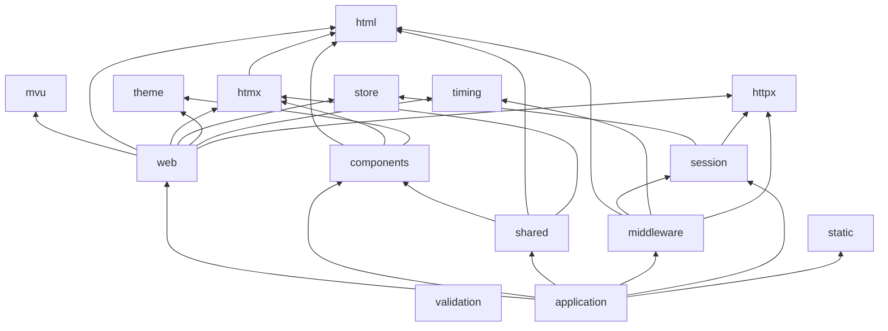
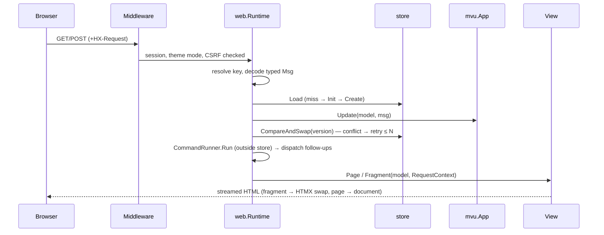

# Architecture

Go SSR framework: MVU state machine on server, HTML streamed by typed
components, HTMX as optional enhancement. No templates, no app JavaScript,
CSS inlined in `<style>`. Source of truth:
[gomvu spec](specs/gomvu-chat-spec.md); decisions: [ADRs](adr/README.md).

## Packages

| Package | Responsibility |
| --- | --- |
| `mvu` | `Application[Model, Msg]`: `Init`, `Update`, `Command`; no HTTP/HTML/storage |
| `html` | `Component`, `Page`, `Fragment`, `Context` (escaping, sticky error, streaming), `El` builder, `Attrs` allowlist |
| `htmx` | typed `Action` attrs, `Request` metadata, response headers |
| `store` | `Snapshot[M]` (`Version`), `Load`/`Create`/`CompareAndSwap`, memory store |
| `session` | signed opaque session ID → model key |
| `theme` | `Theme` (inline CSS), `Mode` system/light/dark, signed `Preference` cookie, adapters |
| `validation` | explicit field errors, no reflection |
| `components` | optional layout, controls, forms, tables, pagination, switcher |
| `shared` | optional native-HTML widgets (accordion, tabs, dialog, …) |
| `static` | embedded HTMX + SRI hash, `/static/` handler |
| `middleware` | security headers/CSP, CSRF, recover, request ID, logging, diagnostics |
| `timing` | nil-safe per-request phase trace in context (decode, dispatch, load, view, render) |
| `httpx` | stdlib-only HTTP error policy, request IDs, Vary merging, response commitment |
| `web` | runtime: route → message → Update → store → commands → view |
| `internal/arch` | boundary enforcement test |
| `benchmarks` | render benchmarks vs `html/template` |

## Dependency rules

Enforced by [internal/arch](../internal/arch/boundaries_test.go)
([ADR-0014](adr/0014-enforced-package-boundaries.md)).

```text
mvu, html, store, theme, static, validation, timing, httpx → stdlib only
htmx       → html
session    → store, httpx
middleware → html, session, timing, httpx
components → html, htmx, theme
shared     → components, html, htmx
web        → mvu, html, htmx, store, theme, timing, httpx
examples   → anything
```



Forbidden: `unsafe`; `reflect` in `html`/`components`; `html/template`,
`text/template` in library code; `mvu` → anything HTTP/HTML/storage.

## Request lifecycle



1. Route method/path check → 405/404.
2. Key from session; message from `Decoder`.
3. Load, init on miss (`ErrAlreadyExists` → retry).
4. `Update` pure; CAS persist; bounded conflict retry.
5. Commands via `CommandRunner` after persist; follow-ups same path.
6. Result mode: page, fragment, 204, redirect, or `RenderAuto`.
7. View gets `RequestContext{Theme, Mode, IsHTMX, HTMX, CurrentURL}`.
8. Stream to `http.ResponseWriter`; error before first byte → `OnError`,
   after → log.

HTTP policy and runtime extensions: [middleware](guides/middleware.md),
[ADR-0019](adr/0019-http-policy-and-runtime-reliability.md).
Late panics abort the stream; ordinary render errors remain logged without
appending a replacement body. HTTP failure after CAS does not undo persistence.

## Page vs fragment

- `html.Page` = full document (`components.Document`). `html.Fragment` =
  swap target subtree. Distinct marker types; runtime cannot mix.
- `RenderAuto`: HTMX → fragment; plain form → 303 `Location`; else page.
  Same route serves HTMX and no-JS clients.

## Rendering

- Components write directly to `html.Context`: `Static`, `Text`,
  `Attribute`, numeric writers, `Trusted(TrustStatic(...))`.
- Sticky first error; no writes after failure.
- One allocation per render (context); see [benchmarks](guides/benchmarks.md).
- Composition via struct fields and slots (`Body`, `Header`, `Children`).
- Application views compose semantic components. Generic HTML and direct
  streaming stay inside named low-level components or explicit demos;
  framework component implementations can stream without a builder.
- `internal/arch/authoring_test.go` type-checks production example files and
  rejects low-level HTML APIs outside two named demo files. It permits
  `Context.Component`, `Components`, `Err`, `Fail` for composition adapters.
- Scope tests keep this authoring convention out of framework code and
  external applications; exact demo exceptions require review rationales.
  Browser-server Go tests are test infrastructure, not production views.
- Package checks recursively discover production Go files (excluding examples,
  benchmarks, testdata and dependency/hidden directories); undeclared packages
  fail, including new subpackages. Theme adapters declare their own boundaries.
- Shared `html.Component` contract remains; no new UI language, virtual DOM,
  package relocation or compulsory rendering layer. See
  [ADR-0018](adr/0018-ui-authoring-boundaries.md).

## Themes

- `Theme.CSS()` inlined by `Document`. Mode → `data-theme`.
- `system` resolved by CSS media query; no JS.
- Adapters (Bootstrap, Bulma, Pico) built offline into `framework.css`.
  See [themes](guides/themes.md).

## Constraints

- `Update`: no HTTP, no HTML, no I/O.
- Views: model → HTML only; no mutation.
- Forms decoded explicitly; validation explicit.
- Store locks never held across Update result use, commands, rendering.
- Components optional; app components live in app.
- No abstractions for hypothetical output formats.
